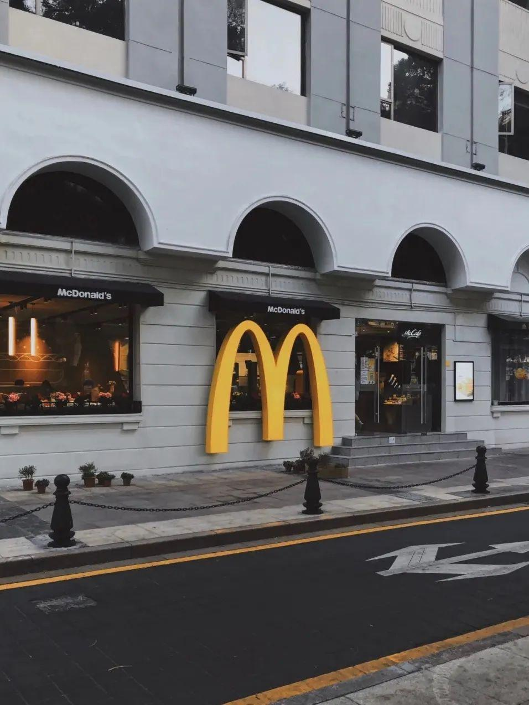
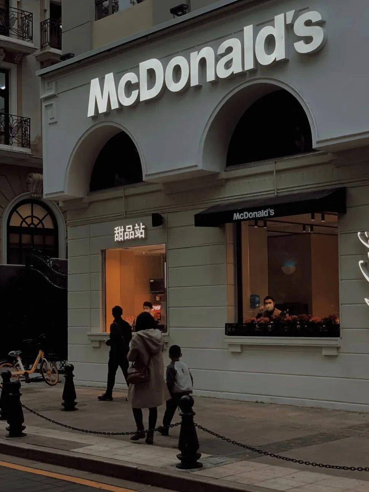
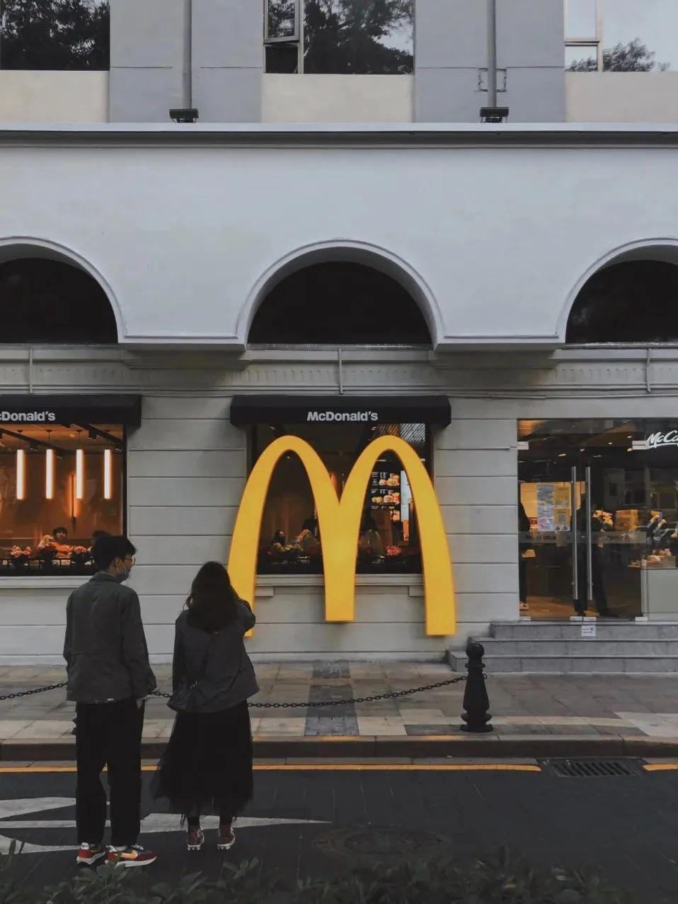
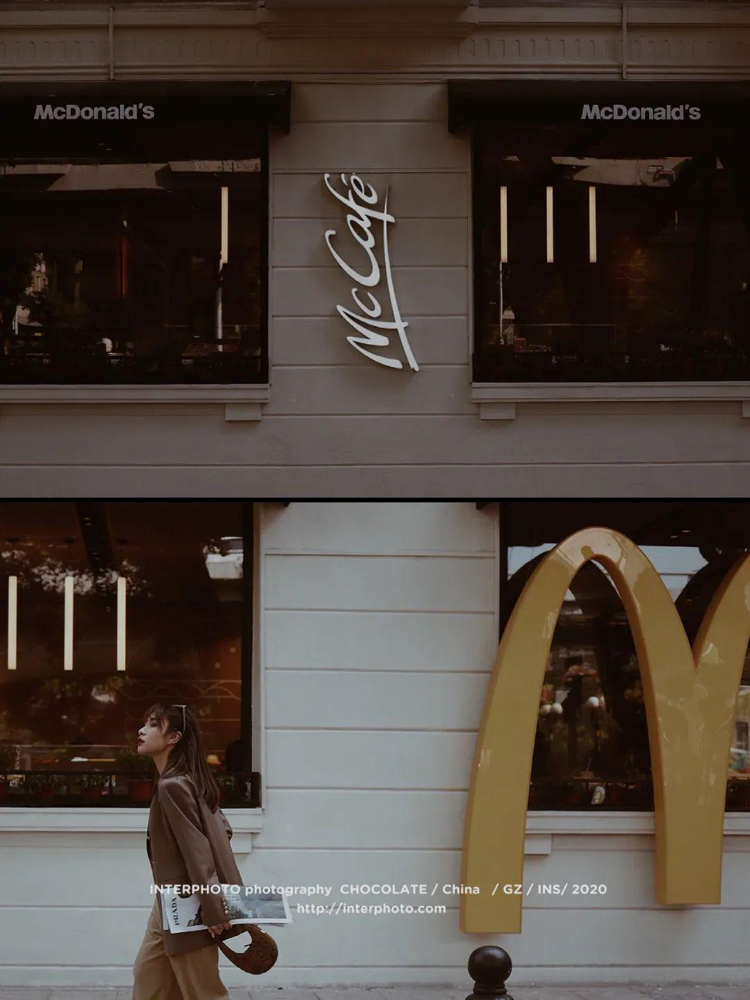
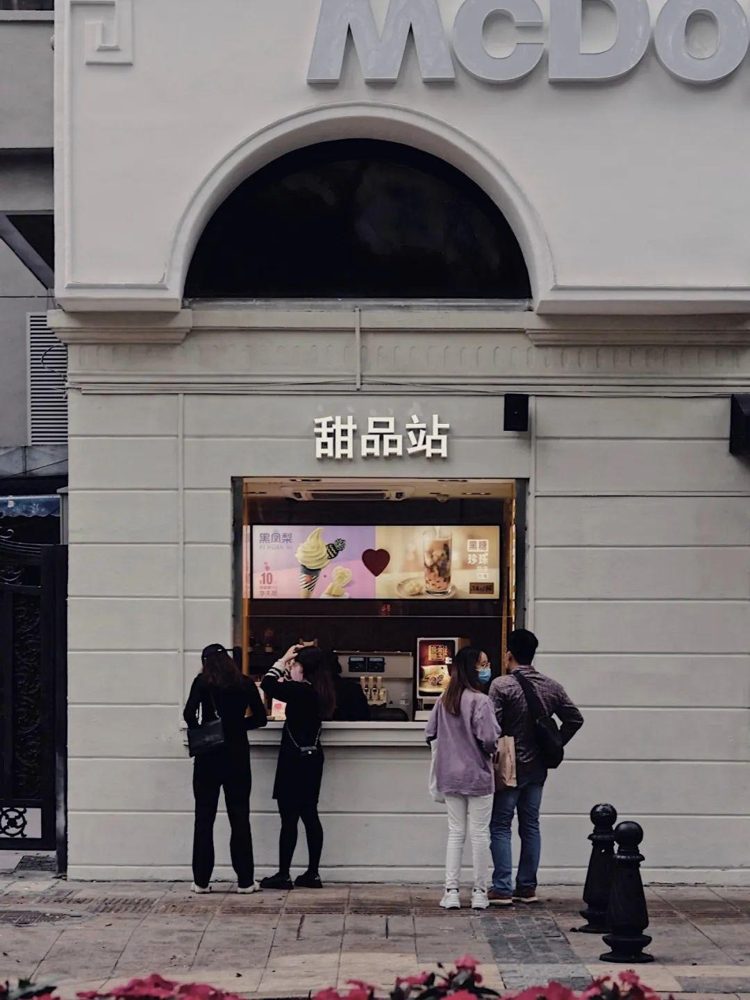
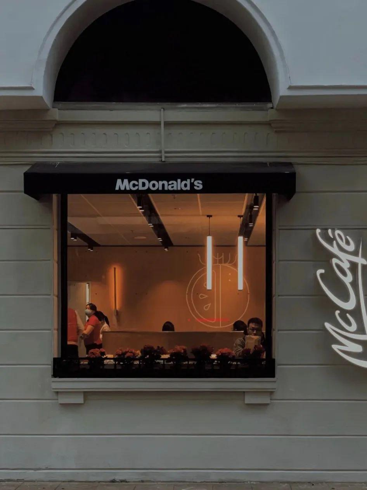
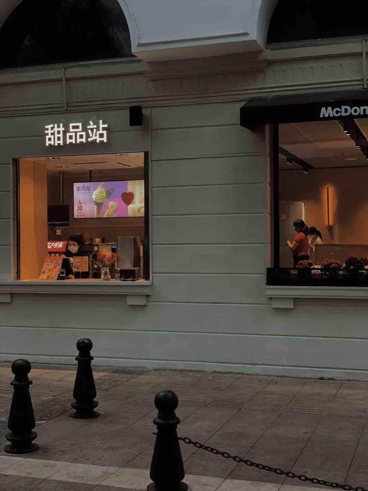
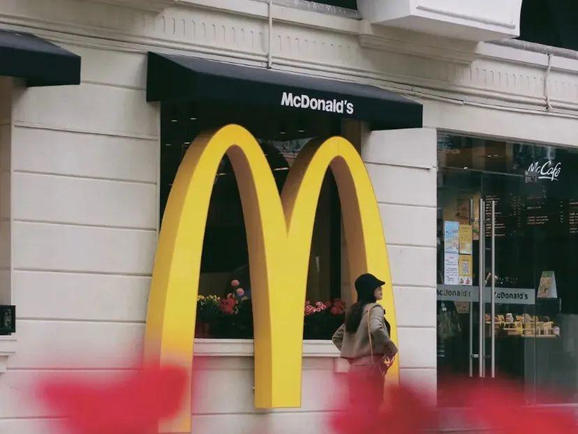
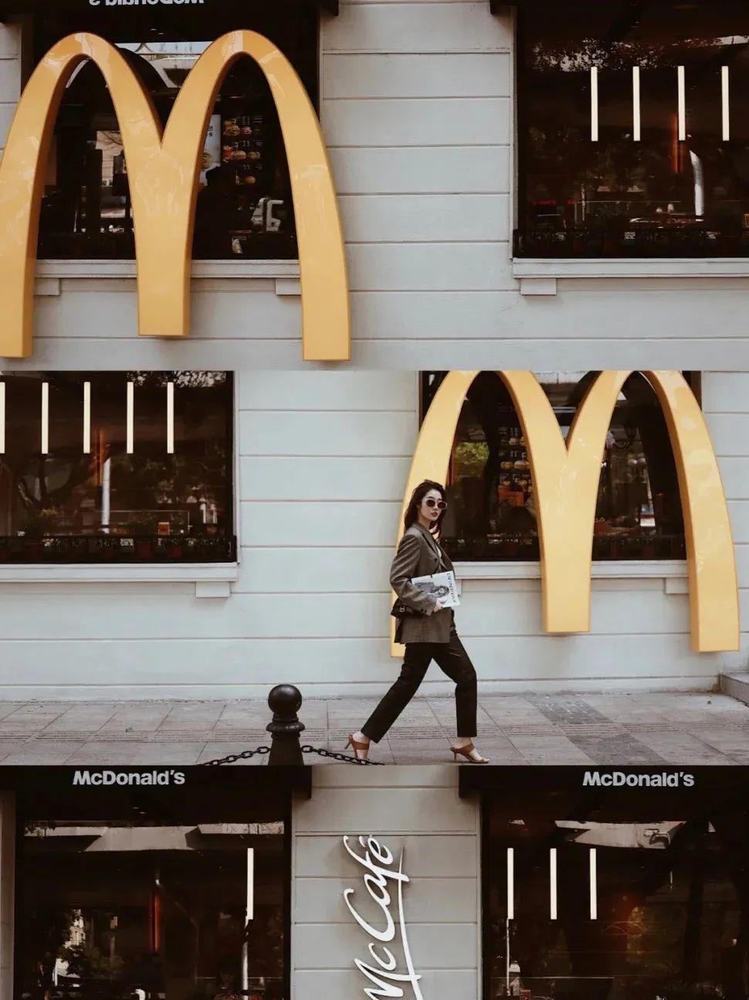
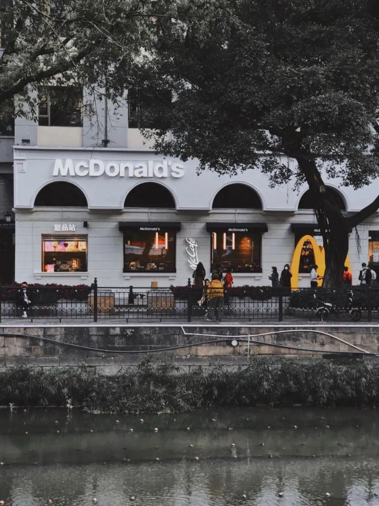

# 麦当劳（沙面店）

**第 1 名 · 综合指数 66 分 · 入选通道：榜单**

荔湾区 · 沙面岛 · 拍照打卡

---

## 基本信息

| 项目 | 内容 |
| --- | --- |
| 门店全称 | 麦当劳（沙面店） |
| 别名 / 平台写法 | 高德登记名「麦当劳(沙面分店)」；平台亦写作沙面分店 / 胜利宾馆店 |
| 地址 | 荔湾区沙面大街 54 号胜利宾馆首层北面厅（店面朝沙面三街一侧，沙面三街 3 号） |
| 地址备注 | 高德登记的「沙面大街 54 号」即胜利宾馆；探店报道写作「沙面三街 3 号」，是同一处建筑的临街门面。 |
| 行政区 / 商圈 | 荔湾区 / 沙面岛 |
| 高德评分 | 4.9 |
| 高德榜单表现 | 快餐简餐榜·白领 第 1；汉堡快餐榜·白领 第 1；麦当劳榜·家庭 第 1；麦当劳榜·白领 第 2 |
| 开业 / 成立时间 | 2020-01-23 开业（探店报道口径）；工商登记成立日期 2019-12-04 |
| 时间来源 | ★ 第三方探店报道 + 工商登记信息 |
| 面积 | 未公开（探店口径：店内空间不大） |
| 座位数 | 未公开 |
| 店型 / 官方身份 | 拥有广州最大的落地金拱门 M 招牌；沙面欧式复古门店，社交平台长期热门打卡点 |
| 营业时间 | 08:00–22:00（电话邦 / 点评口径）；Trip.com 记为 07:00–22:00，存在差异 |
| 电话 | 020-88501302 |
| 交通 | 地铁 1 / 6 号线黄沙站 E 口，步行约 500 米；沙面岛北侧入口桥头 |

## 综合指数（满分 100）

| 维度 | 得分 | 满分 | 说明 |
| --- | --- | --- | --- |
| A 高德榜单表现 | 40 | 40 | 上榜次数 + 最好名次 |
| B 门店规模 | 6 | 20 | 面积 + 座位数 |
| C 商圈能级 | 20 | 20 | 城市级地标 20 / 一级商圈 15 / 区域中心 11 / 成熟社区 7 / 城郊园区 3 |
| D 官方身份 | 0 | 20 | 旗舰、首发、里程碑店型 |
| **合计** | **66** | 100 | 含推定项：面积/座位 |

## 门店与空间

- **面积 / 座位**：未公开（探店口径：店内空间不大）；未公开
- **店型与身份**：拥有广州最大的落地金拱门 M 招牌；沙面欧式复古门店，社交平台长期热门打卡点
- **营业时间**：08:00–22:00（电话邦 / 点评口径）；Trip.com 记为 07:00–22:00，存在差异
- **怎么去**：地铁 1 / 6 号线黄沙站 E 口，步行约 500 米；沙面岛北侧入口桥头

## 实拍

共 12 张，来源：网易号探店稿《这么复古的麦当劳，怎么能用来吃呢…》（网易号（用户上传））。图片版权归原作者 / 品牌方所有。

> 核验依据：网易号探店稿实拍，画面为沙面胜利宾馆首层临街店面（沙面三街一侧）。

### 外立面 / 门头（EXT）

*`01_沙面_EXT_01.jpg`*

*`01_沙面_EXT_02.jpg`*

*`01_沙面_EXT_03.jpg`*

*`01_沙面_EXT_04.jpg`*

*`01_沙面_EXT_05.jpg`*

### 点餐前台 / 甜品站（CNT）

*`01_沙面_CNT_01.jpg`*

*`01_沙面_CNT_02.jpg`*

### 招牌细节 / 品牌元素（SIGN）

*`01_沙面_SIGN_01.jpg`*

*`01_沙面_SIGN_02.jpg`*

*`01_沙面_SIGN_03.jpg`*

*`01_沙面_SIGN_04.jpg`*

### 周边环境（ENV）

*`01_沙面_ENV_01.jpg`*

> 该店暂未找到公开可下载的：座位区、儿童区 实拍。

### 照片来源

- 大众点评（门店页 / 用户相册）：https://www.dianping.com/review/240300543
- 携程攻略（沙面店，含实拍评价）：https://hk.trip.com/restaurant/china/guangzhou/detail/city-81982772
- 网易号探店稿（本文照片出处）：https://www.163.com/dy/article/F7T10MAK05421ZTT.html
- 搜狐探店稿（同店另一组实拍）：https://www.sohu.com/a/382236522_391256

- 本店照片原始出处：网易号探店稿《这么复古的麦当劳，怎么能用来吃呢…》（https://www.163.com/dy/article/F7T10MAK05421ZTT.html）
- 版权说明：网络公开图片，版权归原作者所有，本档案仅作个人研究与非商业展示
- 明细见 `photos/_sources.csv`

## 网上风评

### 好评

1. 纯白欧式外立面配超大落地 M 招牌，白天、傍晚各有一版效果，出片率是全市门店里最高的一档
2. 麦咖啡与甜品站都齐备，是沙面岛上少有的「有座位、有咖啡、有空调」的落脚点
3. 沙面岛本身安静，工作日店内客流舒缓，适合久坐看书、办公，老外与亲子客群比例高

### 差评与短板

1. 店内面积小、座位少，探店与点评都反复提到「用餐位置不算很多」
2. 不少促销活动这家店不参与，套餐价格比市区普通门店略高
3. 白天门口拍照的人常排着队，想拍一张干净的 M logo 需要挑时段；节假日常需拼台

> 口碑内容整合自大众点评、开饭喇、携程 / Trip.com、新浪实测稿等公开页面。点评与开饭喇站点有反爬拦截，相关内容来自搜索引擎摘要，**未经页面原文逐条核对**；差评为归纳转述，非用户原话逐字引用。

## 适合什么场景

拍照打卡 / 咖啡久坐 / 沙面岛半日游中继站

## 待核项与数据说明

- 面积未公开，未按照片目测反推。
- 座位数未公开。
- 规模维度为推定值（面积/座位），取候选池同维度中位档，已在此标注。
- 数据采集日期：2026-10-24。榜单与评分每日变动，以上仅为当日快照。

---

*本文件为个人研究用途整理，图片版权归原作者 / 麦当劳中国所有，如有侵权请联系删除。*
