# 麦当劳（北京路丽都酒店店）

**第 2 名 · 综合指数 62 分 · 入选通道：榜单**

越秀区 · 北京路步行街 · 逛街歇脚

---

## 基本信息

| 项目 | 内容 |
| --- | --- |
| 门店全称 | 麦当劳（北京路丽都酒店店） |
| 别名 / 平台写法 | 平台亦写作「麦当劳(丽都店)」「广州丽都大酒店分店」 |
| 地址 | 越秀区北京路 182 号丽都大酒店首层、二层（近永汉电影院） |
| 地址备注 | 一层为甜品站，堂食区在二层。 |
| 行政区 / 商圈 | 越秀区 / 北京路步行街 |
| 高德评分 | 4.4 |
| 高德榜单表现 | 西式快餐榜·白领 第 8；麦当劳榜·游客 第 9；麦当劳榜·家庭 第 10；麦当劳榜·白领 第 10 |
| 开业 / 成立时间 | 不详（公开渠道未见确切开业年份；该店为北京路老店，近年重新装修） |
| 时间来源 | ○ 未查到；仅能从平台点评时间线确认 2012 年已在营业 |
| 面积 | 未公开 |
| 座位数 | 未公开（点评口径：面积不大，高峰需拼台） |
| 店型 / 官方身份 | 北京路步行街路口 24 小时店，一层甜品站 + 二层堂食；二层整面玻璃可俯瞰步行街十字路口 |
| 营业时间 | 24 小时营业 |
| 电话 | 020-83330006 |
| 交通 | 地铁 6 号线北京路站 B 口步行约 300 米；北京路与大马站路交界 |

## 综合指数（满分 100）

| 维度 | 得分 | 满分 | 说明 |
| --- | --- | --- | --- |
| A 高德榜单表现 | 36 | 40 | 上榜次数 + 最好名次 |
| B 门店规模 | 6 | 20 | 面积 + 座位数 |
| C 商圈能级 | 20 | 20 | 城市级地标 20 / 一级商圈 15 / 区域中心 11 / 成熟社区 7 / 城郊园区 3 |
| D 官方身份 | 0 | 20 | 旗舰、首发、里程碑店型 |
| **合计** | **62** | 100 | 含推定项：面积/座位 |

## 门店与空间

- **面积 / 座位**：未公开；未公开（点评口径：面积不大，高峰需拼台）
- **店型与身份**：北京路步行街路口 24 小时店，一层甜品站 + 二层堂食；二层整面玻璃可俯瞰步行街十字路口
- **营业时间**：24 小时营业
- **怎么去**：地铁 6 号线北京路站 B 口步行约 300 米；北京路与大马站路交界

## 实拍

共 12 张，来源：大众点评门店相册（用户实拍），经 360 图片搜索索引取得（用户实拍）。图片版权归原作者 / 品牌方所有。

> 核验依据：点评「麦当劳(丽都店)」门店相册——「丽都店」即本店在点评的写法；画面特征与门店描述一致（一层甜品站 + 二层堂食、二层整面玻璃临街）。

### 外立面 / 门头（EXT）

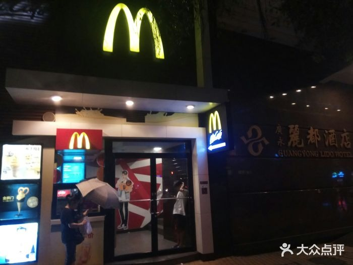

*`02_丽都_EXT_01.jpg`*

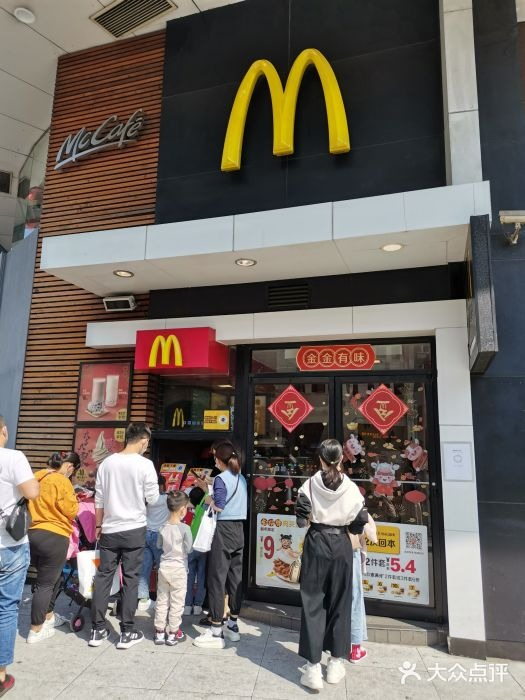

*`02_丽都_EXT_02.jpg`*

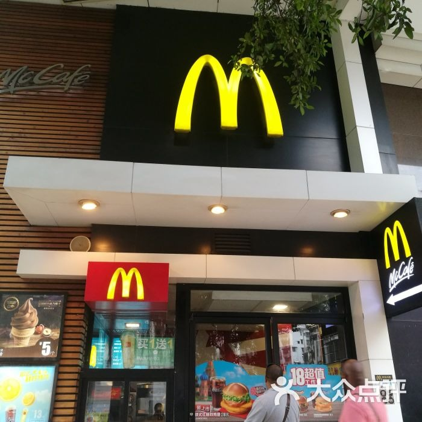

*`02_丽都_EXT_03.jpg`*

### 点餐前台（CNT）

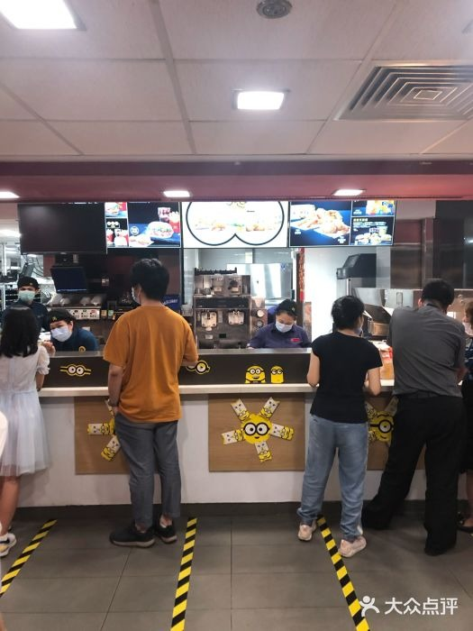

*`02_丽都_CNT_01.jpg`*

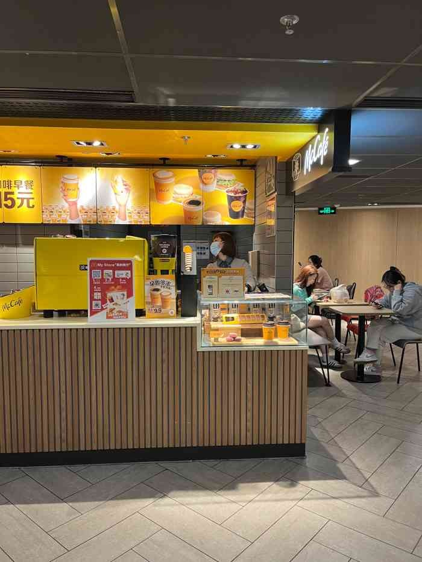

*`02_丽都_CNT_02.jpg`*

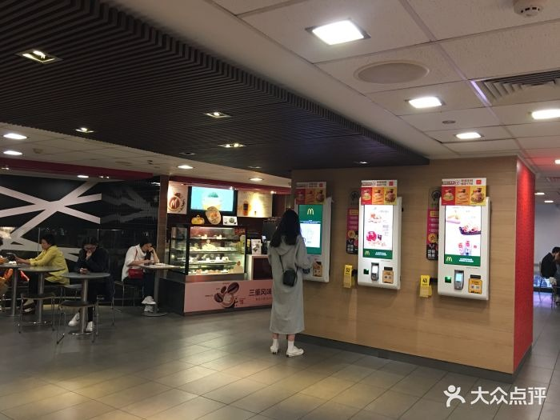

*`02_丽都_CNT_03.jpg`*

### 座位区（SEAT）

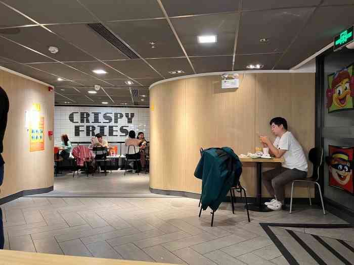

*`02_丽都_SEAT_01.jpg`*

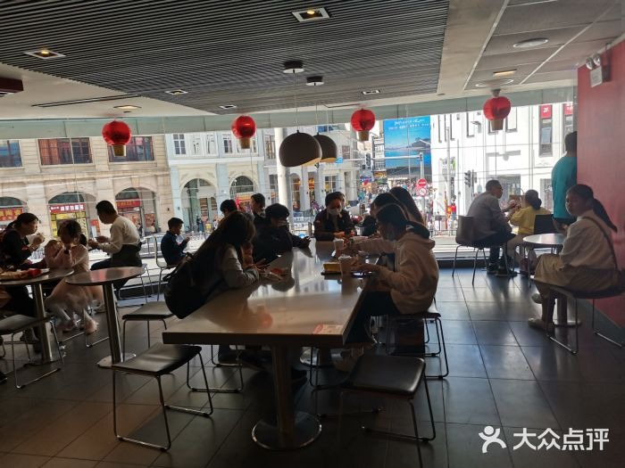

*`02_丽都_SEAT_02.jpg`*

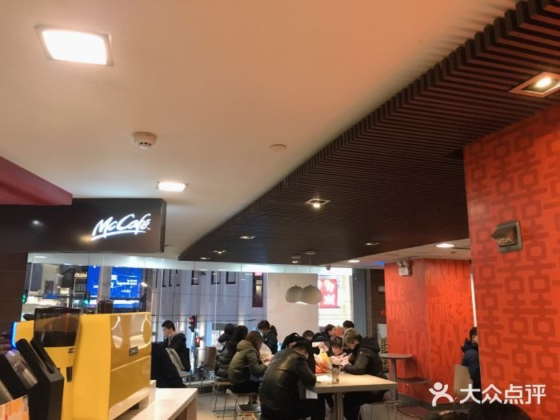

*`02_丽都_SEAT_03.jpg`*

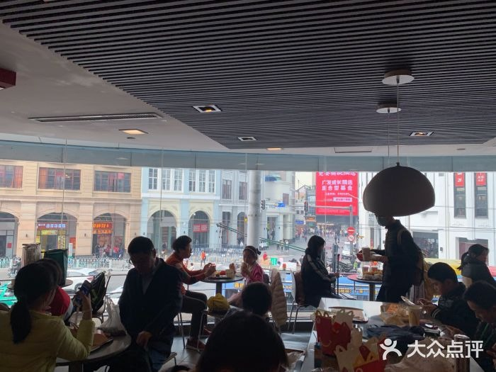

*`02_丽都_SEAT_04.jpg`*

### 招牌细节（SIGN）

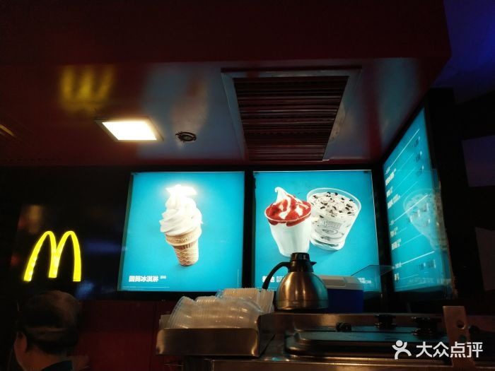

*`02_丽都_SIGN_01.jpg`*

### 周边环境（ENV）

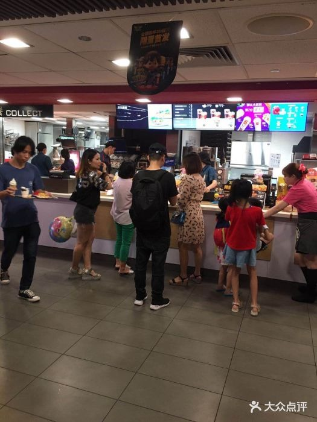

*`02_丽都_ENV_01.jpg`*

> 该店暂未找到公开可下载的：儿童区 实拍。

### 照片来源

- 开饭喇（相片 26 张、食记 13 篇）：https://www.openrice.com.cn/zh/guangzhou/r-%E9%BA%A5%E7%95%B6%E5%8B%9E-%E5%8C%97%E4%BA%AC%E8%B7%AF-%E8%A5%BF%E5%BC%8F-r8529688
- 大众点评（284 条评论 / 用户相册）：https://www.dianping.com/review/240300543
- Trip.com（门店页与评价）：https://hk.trip.com/restaurant/china/guangzhou/detail/restaurant-11476708

- 本店照片原始出处：大众点评门店相册（用户实拍），经 360 图片搜索索引取得（https://www.dianping.com/guangzhou（原图直链见 photos/_sources.csv））
- 版权说明：图片版权归原作者所有，本档案仅作个人研究与非商业展示
- 明细见 `photos/_sources.csv`

## 网上风评

### 好评

1. 24 小时营业，是北京路一带深夜少有的稳定选择
2. 二层靠窗位是一整面玻璃，能直接看到北京路十字路口人流，被不少点评称为「复古机位」
3. 老店重新装修后明亮干净，人工 / 自助机 / 小程序三种点餐方式都在，出餐快

### 差评与短板

1. 高峰期座位紧张，常需要拼台，临窗好位置难抢
2. 老客反映店内灯光偏暗、面积不大，环境评价一般
3. 有顾客反馈自助点餐出现过配错餐（要薯条给了麦乐鸡）的情况

> 口碑内容整合自大众点评、开饭喇、携程 / Trip.com、新浪实测稿等公开页面。点评与开饭喇站点有反爬拦截，相关内容来自搜索引擎摘要，**未经页面原文逐条核对**；差评为归纳转述，非用户原话逐字引用。

## 适合什么场景

逛街歇脚 / 深夜宵夜 / 等人碰头 / 二层窗边拍照

## 待核项与数据说明

- 开业时间未查到确切来源，已如实标注「不详」，未做推测。
- 面积未公开，未按照片目测反推。
- 座位数未公开。
- 规模维度为推定值（面积/座位），取候选池同维度中位档，已在此标注。
- 数据采集日期：2026-10-24。榜单与评分每日变动，以上仅为当日快照。

---

*本文件为个人研究用途整理，图片版权归原作者 / 麦当劳中国所有，如有侵权请联系删除。*
