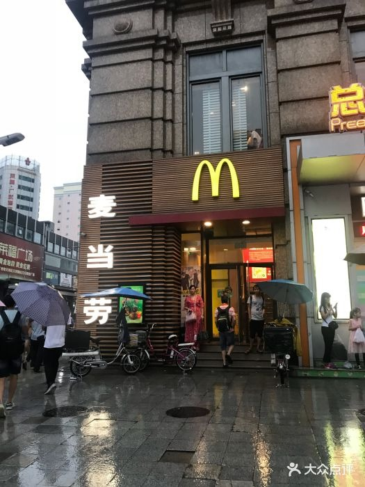
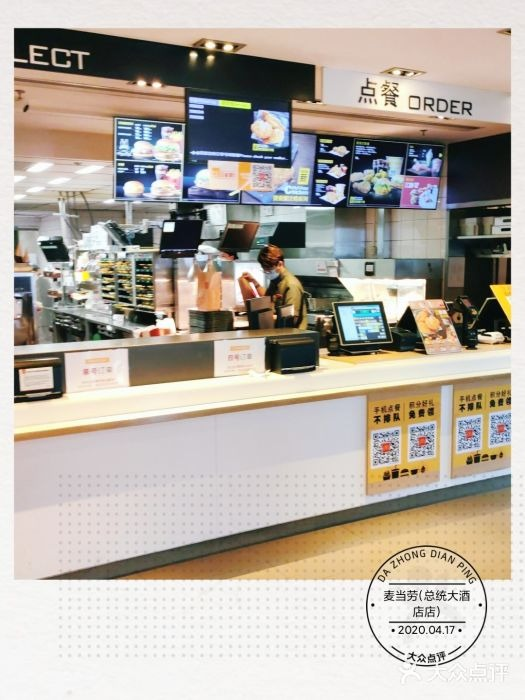
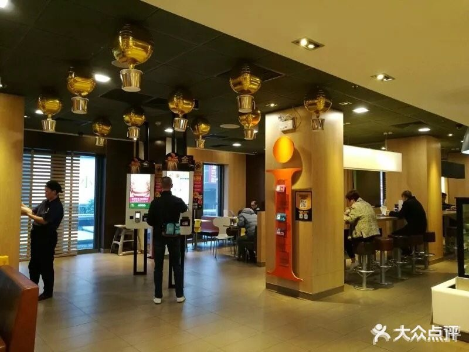

# 麦当劳（总统大酒店店）

**第 4 名 · 综合指数 57 分 · 入选通道：榜单**

天河区 · 岗顶 · 电脑城逛街

---

## 基本信息

| 项目 | 内容 |
| --- | --- |
| 门店全称 | 麦当劳（总统大酒店店） |
| 别名 / 平台写法 | 高德登记名「麦当劳(总统大酒店店)」，因位于南方电脑城 2 层，平台亦写作「南方电脑城店」「天河路餐厅」 |
| 地址 | 天河区天河路 518 号南方电脑城 2 层（总统大酒店裙楼，面向天河路主干道） |
| 地址备注 | 同店在多个平台有 4 个以上别名，本档案统一用高德的「总统大酒店店」。 |
| 行政区 / 商圈 | 天河区 / 岗顶 |
| 高德评分 | 4.5 |
| 高德榜单表现 | 麦当劳榜·学生 第 7；麦当劳榜·白领 第 7；麦当劳榜·家庭 第 8；麦当劳榜·游客 第 8 |
| 开业 / 成立时间 | 不详（所在南方电脑城 2000 年代已运营；公开渠道未见确切开业年份） |
| 时间来源 | ○ 未查到 |
| 面积 | 未公开 |
| 座位数 | 约 200 座（第三方生活服务平台 2012 年登记，未现场核实） |
| 店型 / 官方身份 | 普通门店，但为岗顶商圈 24 小时主力店；设夹层就餐区 |
| 营业时间 | 24 小时营业 |
| 电话 | 020-38788787 |
| 交通 | 地铁 3 号线岗顶站 C 口向北步行 2–3 分钟；BRT 岗顶站下车步行约 200 米 |

## 综合指数（满分 100）

| 维度 | 得分 | 满分 | 说明 |
| --- | --- | --- | --- |
| A 高德榜单表现 | 36 | 40 | 上榜次数 + 最好名次 |
| B 门店规模 | 6 | 20 | 面积 + 座位数 |
| C 商圈能级 | 15 | 20 | 城市级地标 20 / 一级商圈 15 / 区域中心 11 / 成熟社区 7 / 城郊园区 3 |
| D 官方身份 | 0 | 20 | 旗舰、首发、里程碑店型 |
| **合计** | **57** | 100 | 含推定项：面积/座位 |

## 门店与空间

- **面积 / 座位**：未公开；约 200 座（第三方生活服务平台 2012 年登记，未现场核实）
- **店型与身份**：普通门店，但为岗顶商圈 24 小时主力店；设夹层就餐区
- **营业时间**：24 小时营业
- **怎么去**：地铁 3 号线岗顶站 C 口向北步行 2–3 分钟；BRT 岗顶站下车步行约 200 米

## 实拍

共 3 张，来源：大众点评门店相册（用户实拍），经 360 图片搜索索引取得（用户实拍）。图片版权归原作者 / 品牌方所有。

> 核验依据：点评「麦当劳(总统大酒店店)」门店相册；点餐前台照自带点评水印「麦当劳(总统大酒店店) 2020.04.17」，店名与门店直接对应。

### 外立面 / 门头（EXT）

*`04_总统_EXT_01.jpg`*

### 点餐前台（CNT）

*`04_总统_CNT_01.jpg`*

### 座位区（SEAT）

*`04_总统_SEAT_01.jpg`*

> 该店暂未找到公开可下载的：儿童区、招牌细节、周边环境 实拍。

### 照片来源

- 百度百科（门店条目，含交通与营业信息）：https://baike.baidu.com/item/%E9%BA%A6%E5%BD%93%E5%8A%B3(%E6%80%BB%E7%BB%9F%E5%A4%A7%E9%85%92%E5%BA%97%E5%BA%97)/14275886
- 大众点评（用户点评）：https://www.dianping.com/review/451002222
- 8090 本地生活（座位数 / 别名登记）：https://life.city8090.com/guangzhou/s_768738

- 本店照片原始出处：大众点评门店相册（用户实拍），经 360 图片搜索索引取得（https://www.dianping.com/guangzhou（原图直链见 photos/_sources.csv））
- 版权说明：图片版权归原作者所有，本档案仅作个人研究与非商业展示
- 明细见 `photos/_sources.csv`

## 网上风评

### 好评

1. 24 小时营业，岗顶电脑城、中山三院、周边高校客群稳定，深夜仍有热食
2. 座位约 200 个，是本次入选门店里少数明确记载「座位多」的一家，还有夹层就餐区
3. 点餐到取餐流程成熟，非促销日常态下出餐很快

### 差评与短板

1. 促销活动日（如 5 元汉堡）人流量爆棚，有顾客等餐接近一小时
2. 人太多时难找座位，部分桌面清理不及时
3. 服务态度评价偏一般，有「叫了几次没人来收台」的吐槽

> 口碑内容整合自大众点评、开饭喇、携程 / Trip.com、新浪实测稿等公开页面。点评与开饭喇站点有反爬拦截，相关内容来自搜索引擎摘要，**未经页面原文逐条核对**；差评为归纳转述，非用户原话逐字引用。

## 适合什么场景

电脑城逛街 / 医院陪诊等候 / 深夜宵夜 / 学生聚餐

## 待核项与数据说明

- 开业时间未查到确切来源，已如实标注「不详」，未做推测。
- 面积未公开，未按照片目测反推。
- 规模维度为推定值（面积/座位），取候选池同维度中位档，已在此标注。
- 数据采集日期：2026-10-24。榜单与评分每日变动，以上仅为当日快照。

---

*本文件为个人研究用途整理，图片版权归原作者 / 麦当劳中国所有，如有侵权请联系删除。*
