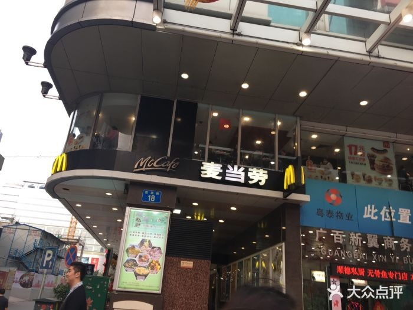
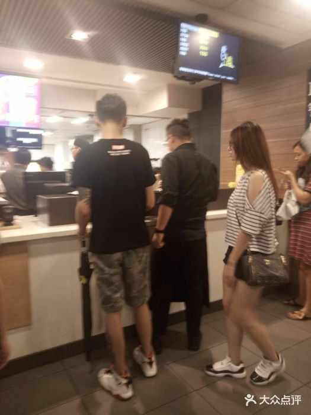
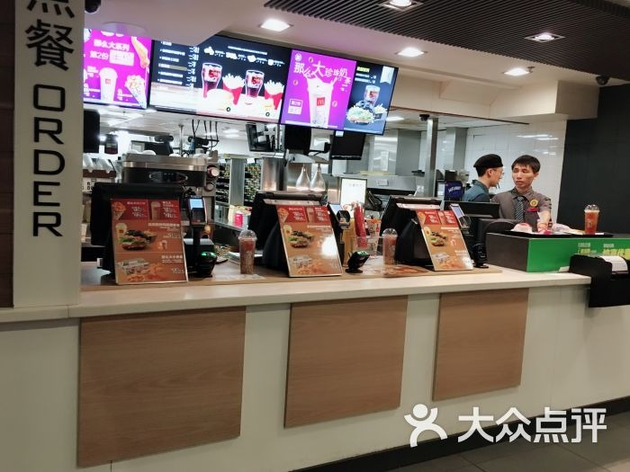
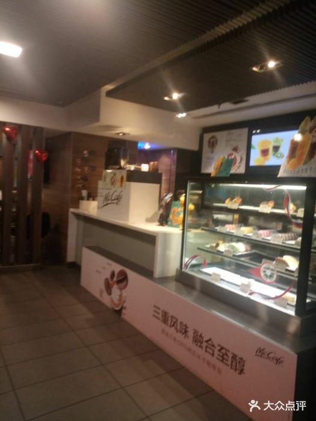
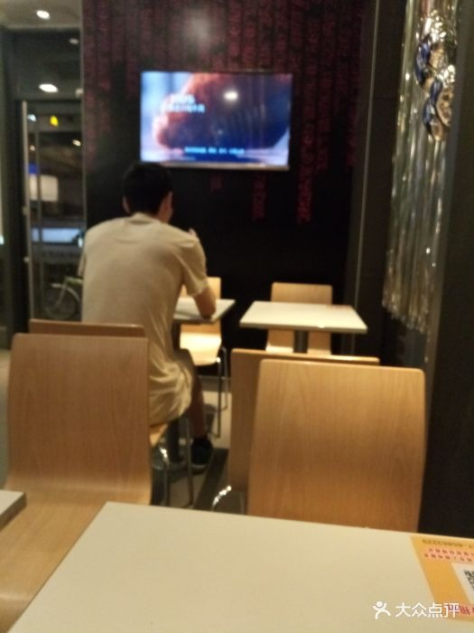
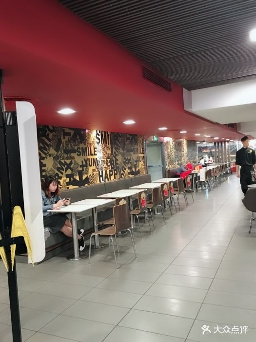
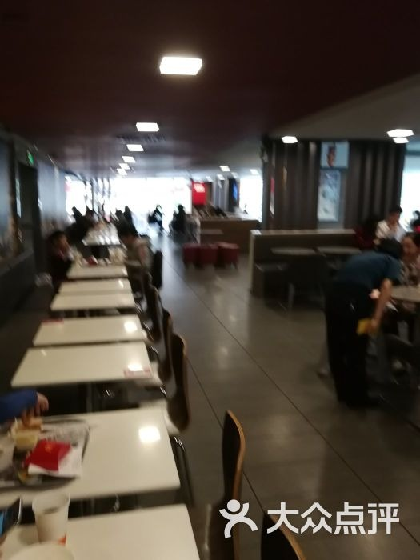
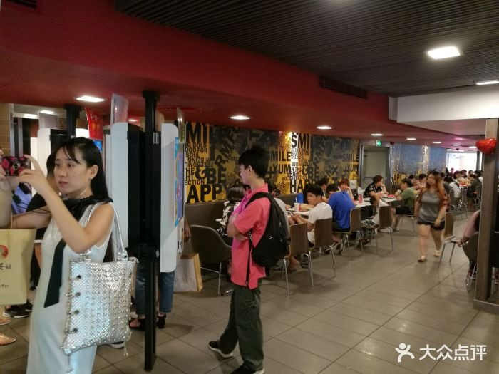
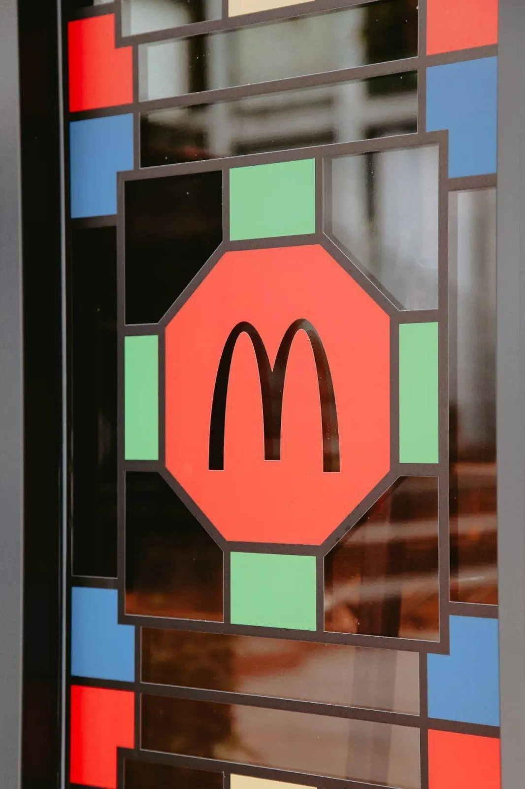
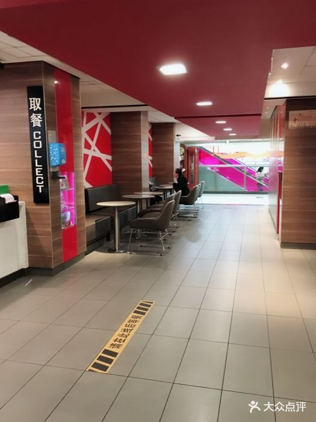

# 麦当劳（北京路广百广场店）

**第 5 名 · 综合指数 56 分 · 入选通道：榜单**

越秀区 · 北京路步行街 · 北京路逛街中途休息

---

## 基本信息

| 项目 | 内容 |
| --- | --- |
| 门店全称 | 麦当劳（北京路广百广场店） |
| 别名 / 平台写法 | 平台亦写作「麦当劳(广百新翼商务中心店)」「北京路广百百货店」 |
| 地址 | 越秀区西湖路至大马站路段 广百广场新翼首层及夹层 |
| 地址备注 | 另有平台登记为「北京路 295 号广百百货 M 层至 F1 层」并记座位约 200 个，疑为同一门店的不同登记口径，未现场核实。 |
| 行政区 / 商圈 | 越秀区 / 北京路步行街 |
| 高德评分 | 4.8 |
| 高德榜单表现 | 麦当劳榜·学生 第 3；麦当劳榜·老年人 第 4；汉堡快餐榜·白领 第 7 |
| 开业 / 成立时间 | 不详（公开渠道未见确切开业年份） |
| 时间来源 | ○ 未查到 |
| 面积 | 未公开 |
| 座位数 | 约 200 座（开饭喇登记，未现场核实） |
| 店型 / 官方身份 | 普通门店；位于广百新翼首层+夹层，开放式店面 |
| 营业时间 | 07:00–23:00 |
| 电话 | 020-83384341（广百新翼）；020-83327929（广百百货） |
| 交通 | 地铁 6 号线北京路站 B 口；北京路步行街西侧，大马站路一侧进入 |

## 综合指数（满分 100）

| 维度 | 得分 | 满分 | 说明 |
| --- | --- | --- | --- |
| A 高德榜单表现 | 30 | 40 | 上榜次数 + 最好名次 |
| B 门店规模 | 6 | 20 | 面积 + 座位数 |
| C 商圈能级 | 20 | 20 | 城市级地标 20 / 一级商圈 15 / 区域中心 11 / 成熟社区 7 / 城郊园区 3 |
| D 官方身份 | 0 | 20 | 旗舰、首发、里程碑店型 |
| **合计** | **56** | 100 | 含推定项：面积/座位 |

## 门店与空间

- **面积 / 座位**：未公开；约 200 座（开饭喇登记，未现场核实）
- **店型与身份**：普通门店；位于广百新翼首层+夹层，开放式店面
- **营业时间**：07:00–23:00
- **怎么去**：地铁 6 号线北京路站 B 口；北京路步行街西侧，大马站路一侧进入

## 实拍

共 10 张，来源：大众点评门店相册（用户实拍），经 360 图片搜索索引取得（用户实拍）。图片版权归原作者 / 品牌方所有。

> 核验依据：点评「麦当劳(广百店)」门店相册；外立面照可读到「广百新翼商务」招牌，与本店所在广百广场新翼一致。

### 外立面 / 门头（EXT）

*`05_广百_EXT_01.jpg`*

### 点餐前台（CNT）

*`05_广百_CNT_01.jpg`*

*`05_广百_CNT_02.jpg`*

*`05_广百_CNT_03.jpg`*

### 座位区（SEAT）

*`05_广百_SEAT_01.jpg`*

*`05_广百_SEAT_02.jpg`*

*`05_广百_SEAT_03.jpg`*

*`05_广百_SEAT_04.jpg`*

### 招牌细节（SIGN）

*`05_广百_SIGN_01.jpg`*

### 周边环境（ENV）

*`05_广百_ENV_01.jpg`*

> 该店暂未找到公开可下载的：儿童区 实拍。

### 照片来源

- 开饭喇（相片 90 张、食记 130 篇）：https://www.openrice.com.cn/zh-cn/guangzhou/r-%E9%BA%A6%E5%BD%93%E5%8A%B3-%E5%8C%97%E4%BA%AC%E8%B7%AF-%E6%B1%89%E5%A0%A1%E5%8C%85-r42675
- 携程攻略（465 条点评，4.5 分）：https://you.ctrip.com/food/ctripyouyoustar152/5326336-dianping.html
- Trip.com（门店页）：https://hk.trip.com/restaurant/china/guangzhou/detail/restaurant-11476708/

- 本店照片原始出处：大众点评门店相册（用户实拍），经 360 图片搜索索引取得（https://www.dianping.com/guangzhou（原图直链见 photos/_sources.csv））
- 版权说明：图片版权归原作者所有，本档案仅作个人研究与非商业展示
- 明细见 `photos/_sources.csv`

## 网上风评

### 好评

1. 规模大、座位多，逛完北京路进来休息不容易没位置
2. 被点评形容为「闹中取静」，空调足、环境舒适
3. 早餐买优惠卡后性价比高，薯饼与麦满分系列口碑稳定

### 差评与短板

1. 位置在北京路算偏，在 2 楼（首层及夹层），不仔细看容易错过
2. 被反复提到「洋快餐越来越贵」，价格比国内同类快餐高一档
3. 豆浆为豆浆粉冲调，口感偏甜腻

> 口碑内容整合自大众点评、开饭喇、携程 / Trip.com、新浪实测稿等公开页面。点评与开饭喇站点有反爬拦截，相关内容来自搜索引擎摘要，**未经页面原文逐条核对**；差评为归纳转述，非用户原话逐字引用。

## 适合什么场景

北京路逛街中途休息 / 亲子 / 早餐

## 待核项与数据说明

- 开业时间未查到确切来源，已如实标注「不详」，未做推测。
- 面积未公开，未按照片目测反推。
- 规模维度为推定值（面积/座位），取候选池同维度中位档，已在此标注。
- 数据采集日期：2026-10-24。榜单与评分每日变动，以上仅为当日快照。

---

*本文件为个人研究用途整理，图片版权归原作者 / 麦当劳中国所有，如有侵权请联系删除。*
