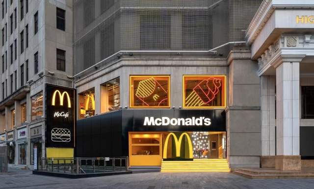
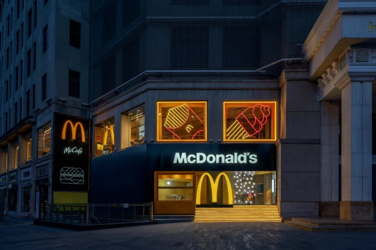
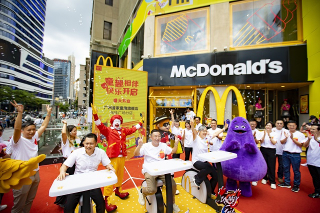
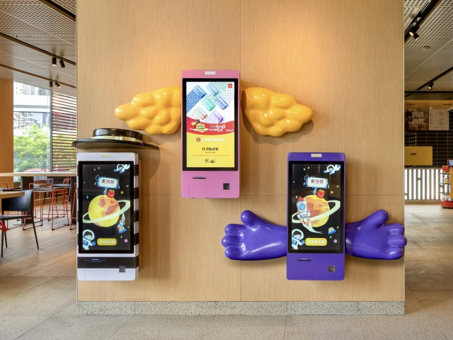
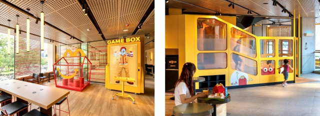
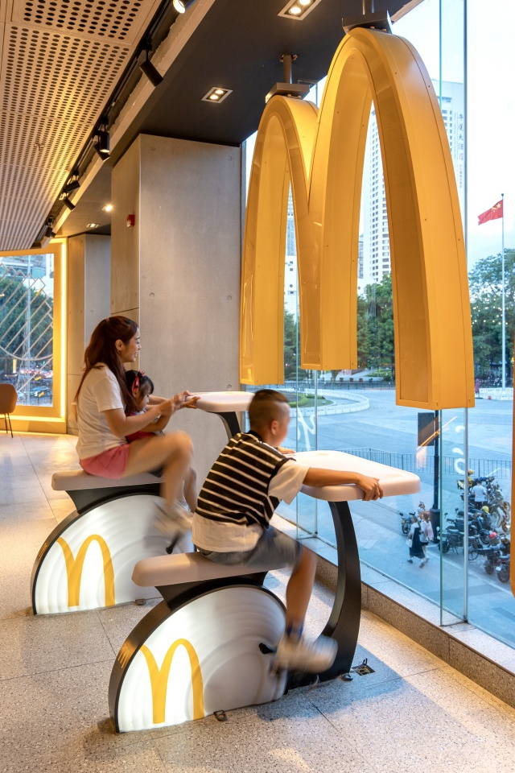
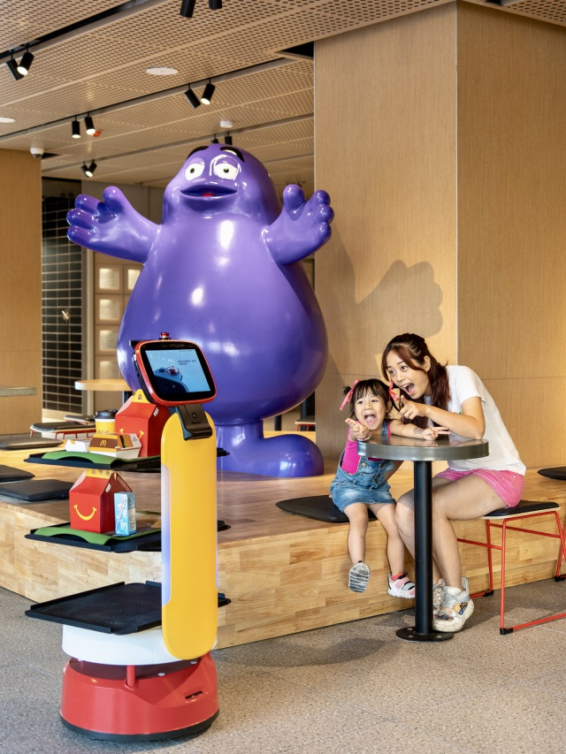

# 麦当劳（海珠广场店）

**第 6 名 · 综合指数 56 分 · 入选通道：地标**

越秀区 · 海珠广场 / 一德路 · 亲子遛娃

---

## 基本信息

| 项目 | 内容 |
| --- | --- |
| 门店全称 | 麦当劳（海珠广场店） |
| 别名 / 平台写法 | 高德登记名「麦当劳(海珠广场店)」；官方称「海珠广场餐厅」 |
| 地址 | 越秀区起义路 1 号海印缤缤广场二层（一德路侧，近广州解放纪念雕像） |
| 地址备注 | 麦当劳中国官网写「海印缤缤广场二层」；Trip.com 登记为「1 层」，以官网为准，现场有扶手电梯直达。 |
| 行政区 / 商圈 | 越秀区 / 海珠广场 / 一德路 |
| 高德评分 | 未收录（开业时间短或样本不足） |
| 高德榜单表现 | 未进入所采集的 8 个高德榜单 |
| 开业 / 成立时间 | 1993 年开业（麦当劳进入广州的第二家餐厅）；2023-08-08 重装升级为广州首家童趣旗舰店 |
| 时间来源 | ★ 麦当劳中国官网新闻稿（2023-08-08） |
| 面积 | 超过 765 平方米，为广州麦当劳面积最大的餐厅 |
| 座位数 | 未公开（点评口径：面积大但仍常坐满） |
| 店型 / 官方身份 | 广州首家童趣旗舰店；RAY 旗舰店设计风格；全国首发「开心小助手」智能机器人「小萌」；全国首发「四小福版」自助点餐机；儿童乐园全国首发设计 |
| 营业时间 | 24 小时营业（第三方实测口径）；Trip.com 记「全日开放」 |
| 电话 | 020-83359150 |
| 交通 | 地铁 2 / 6 号线海珠广场站上盖；一德路、起义路交界 |

## 综合指数（满分 100）

| 维度 | 得分 | 满分 | 说明 |
| --- | --- | --- | --- |
| A 高德榜单表现 | 0 | 40 | 上榜次数 + 最好名次 |
| B 门店规模 | 18 | 20 | 面积 + 座位数 |
| C 商圈能级 | 20 | 20 | 城市级地标 20 / 一级商圈 15 / 区域中心 11 / 成熟社区 7 / 城郊园区 3 |
| D 官方身份 | 18 | 20 | 旗舰、首发、里程碑店型 |
| **合计** | **56** | 100 | 含推定项：座位 |

## 门店与空间

- **面积 / 座位**：超过 765 平方米，为广州麦当劳面积最大的餐厅；未公开（点评口径：面积大但仍常坐满）
- **店型与身份**：广州首家童趣旗舰店；RAY 旗舰店设计风格；全国首发「开心小助手」智能机器人「小萌」；全国首发「四小福版」自助点餐机；儿童乐园全国首发设计
- **营业时间**：24 小时营业（第三方实测口径）；Trip.com 记「全日开放」
- **怎么去**：地铁 2 / 6 号线海珠广场站上盖；一德路、起义路交界

## 实拍

共 7 张，来源：麦当劳中国官网新闻稿（2023-08-08）官方配图（麦当劳中国官网）。图片版权归原作者 / 品牌方所有。

> 核验依据：麦当劳中国官网新闻稿配图（2023-08-08《广州第 13 家家庭主题店》），画面为本店店内。

### 外立面 / 门头（EXT）

*`06_海珠广场_EXT_01.jpg`*

*`06_海珠广场_EXT_02.jpg`*

*`06_海珠广场_EXT_03.jpg`*

### 点餐前台 / 甜品站（CNT）

*`06_海珠广场_CNT_01.jpg`*

### 座位区 / 堂食区（SEAT）

*`06_海珠广场_SEAT_01.jpg`*

*`06_海珠广场_SEAT_02.jpg`*

### 儿童区 / 游乐区（KID）

*`06_海珠广场_KID_01.jpg`*

> 该店暂未找到公开可下载的：招牌细节、周边环境 实拍。

### 照片来源

- 麦当劳中国官网新闻稿（本文照片出处）：https://www.mcdonalds.com.cn/news/20230808-Guangzhou-13-Family-Restaurant
- Trip.com（9 条评价，4.5 分）：https://hk.trip.com/restaurant/china/guangzhou/detail/mcdonald-s-30963570/
- 羊城晚报报道（同批官方图）：https://news.ycwb.com/2023-08/08/content_52126921.htm

- 本店照片原始出处：麦当劳中国官网新闻稿（2023-08-08）官方配图（https://www.mcdonalds.com.cn/news/20230808-Guangzhou-13-Family-Restaurant）
- 版权说明：版权归麦当劳中国所有，本档案仅作个人研究与非商业展示
- 明细见 `photos/_sources.csv`

## 网上风评

### 好评

1. 全市面积最大（765㎡+），座位容量在入选门店里最高一档
2. 二层落地大玻璃正对海珠广场与解放桥，晚上看夜景是这家店独有的体验
3. 2023 年重装后「四小福」巨型雕像、定制自助点餐机、全国首发儿童乐园与智慧机器人「小萌」全在这家，是一站式童趣打卡点；24 小时营业且有麦咖啡

### 差评与短板

1. 面积虽大，但常被坐满，中午需要排队等餐
2. 没有专属母婴室，带低龄宝宝换尿布不方便
3. 儿童乐园设施相对简单，餐食并非专为幼儿设计，更适合「顺路解决一餐」

> 口碑内容整合自大众点评、开饭喇、携程 / Trip.com、新浪实测稿等公开页面。点评与开饭喇站点有反爬拦截，相关内容来自搜索引擎摘要，**未经页面原文逐条核对**；差评为归纳转述，非用户原话逐字引用。

## 适合什么场景

亲子遛娃 / 海珠广场与一德路逛街 / 夜景窗边位 / 24 小时应急

## 待核项与数据说明

- 高德未收录评分：该店未进入所采集的 8 个高德榜单，评分缺失。
- 座位数未公开。
- 规模维度为推定值（座位），取候选池同维度中位档，已在此标注。
- 数据采集日期：2026-10-24。榜单与评分每日变动，以上仅为当日快照。

---

*本文件为个人研究用途整理，图片版权归原作者 / 麦当劳中国所有，如有侵权请联系删除。*
