# 麦当劳（宜安广场店）

**第 8 名 · 综合指数 53 分 · 入选通道：榜单**

越秀区 · 建设六马路 / 淘金 · 写字楼午市

---

## 基本信息

| 项目 | 内容 |
| --- | --- |
| 门店全称 | 麦当劳（宜安广场店） |
| 别名 / 平台写法 | 高德登记名「麦当劳(宜安广场分店餐厅)」 |
| 地址 | 越秀区建设六马路 38 号宜安广场首层（实际需从广场正面右侧下楼梯，位于下层/负一层） |
| 地址备注 | 门牌登记为首层，但多家点评都指出要下楼梯进入，实际在负一层位置。 |
| 行政区 / 商圈 | 越秀区 / 建设六马路 / 淘金 |
| 高德评分 | 4.8 |
| 高德榜单表现 | 麦当劳榜·家庭 第 2；麦当劳榜·老年人 第 2；麦当劳榜·白领 第 3 |
| 开业 / 成立时间 | 不详（公开渠道未见确切开业年份；2019 年前已在营业） |
| 时间来源 | ○ 未查到 |
| 面积 | 未公开（点评口径：店不大） |
| 座位数 | 未公开 |
| 店型 / 官方身份 | 普通门店；以「自选配料 DIY 汉堡」为特色 |
| 营业时间 | 24 小时营业（Trip.com 记「全日开放」） |
| 电话 | 020-83634339 |
| 交通 | 建设六马路 38 号宜安广场；地铁 5 号线淘金站步行约 5 分钟 |

## 综合指数（满分 100）

| 维度 | 得分 | 满分 | 说明 |
| --- | --- | --- | --- |
| A 高德榜单表现 | 32 | 40 | 上榜次数 + 最好名次 |
| B 门店规模 | 6 | 20 | 面积 + 座位数 |
| C 商圈能级 | 15 | 20 | 城市级地标 20 / 一级商圈 15 / 区域中心 11 / 成熟社区 7 / 城郊园区 3 |
| D 官方身份 | 0 | 20 | 旗舰、首发、里程碑店型 |
| **合计** | **53** | 100 | 含推定项：面积/座位 |

## 门店与空间

- **面积 / 座位**：未公开（点评口径：店不大）；未公开
- **店型与身份**：普通门店；以「自选配料 DIY 汉堡」为特色
- **营业时间**：24 小时营业（Trip.com 记「全日开放」）
- **怎么去**：建设六马路 38 号宜安广场；地铁 5 号线淘金站步行约 5 分钟

## 实拍

共 12 张，来源：大众点评门店相册（用户实拍），经 360 图片搜索索引取得（用户实拍）。图片版权归原作者 / 品牌方所有。

> 核验依据：点评「麦当劳(宜安广场店)」门店相册；外立面照可见宜安广场招牌与下沉楼梯，与门店「首层需下楼梯」的描述一致。

### 外立面 / 门头（EXT）

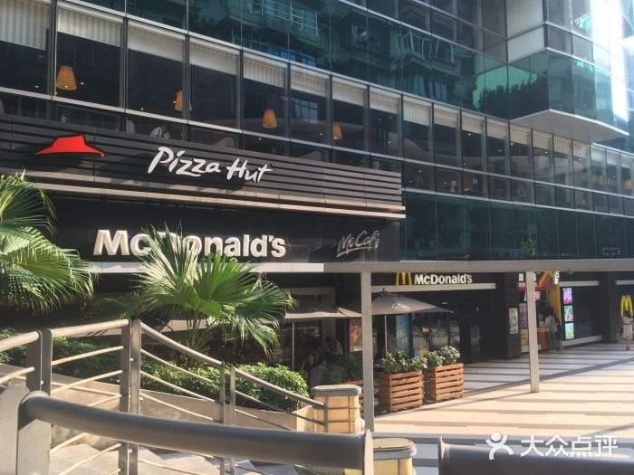

*`08_宜安_EXT_01.jpg`*

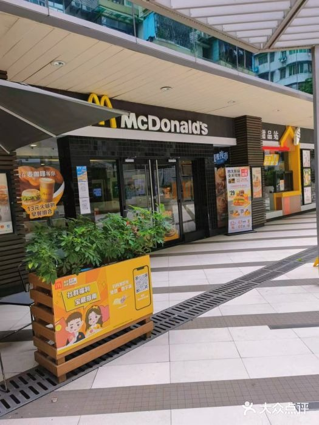

*`08_宜安_EXT_02.jpg`*

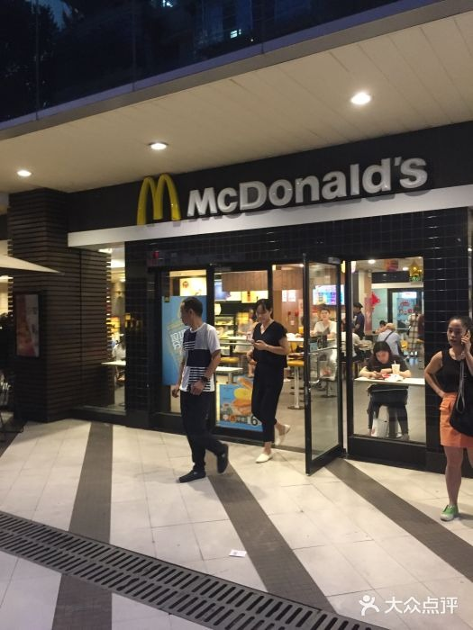

*`08_宜安_EXT_03.jpg`*

### 点餐前台（CNT）

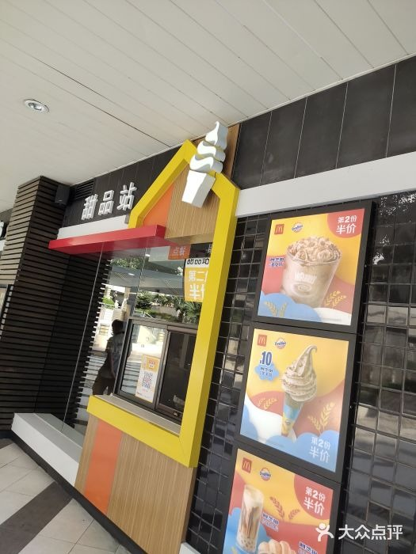

*`08_宜安_CNT_01.jpg`*

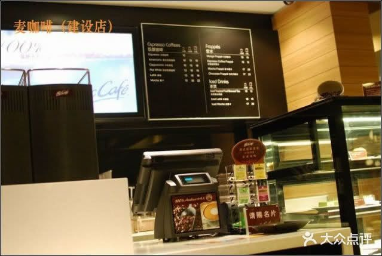

*`08_宜安_CNT_02.jpg`*

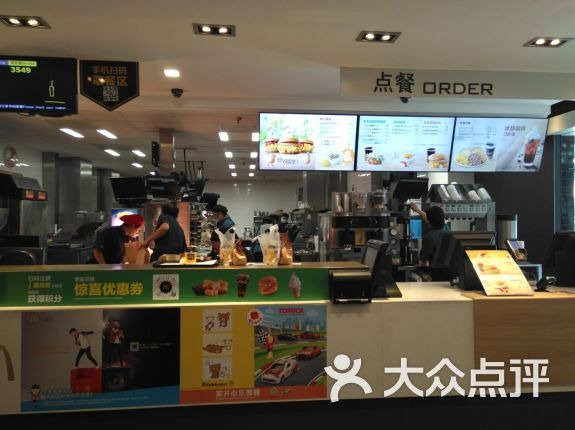

*`08_宜安_CNT_03.jpg`*

### 座位区（SEAT）

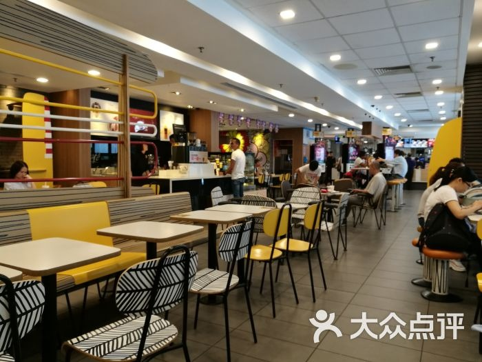

*`08_宜安_SEAT_01.jpg`*

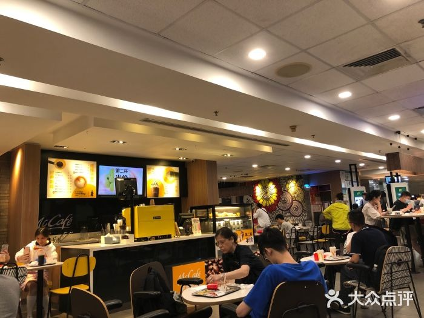

*`08_宜安_SEAT_02.jpg`*

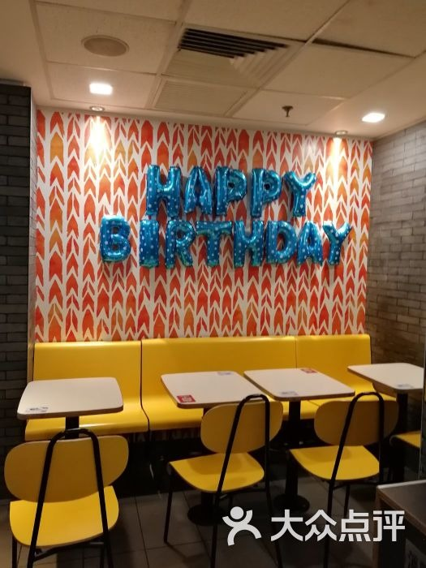

*`08_宜安_SEAT_03.jpg`*

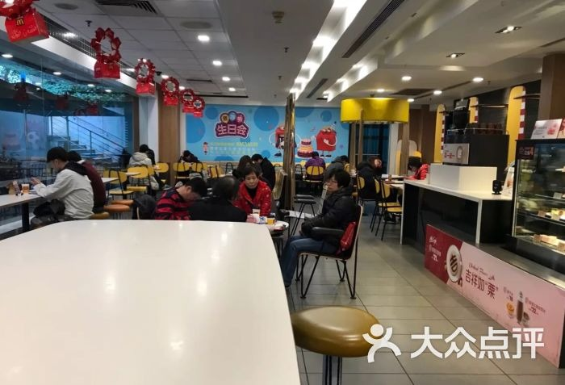

*`08_宜安_SEAT_04.jpg`*

### 招牌细节（SIGN）

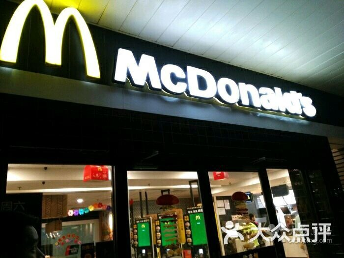

*`08_宜安_SIGN_01.jpg`*

### 周边环境（ENV）

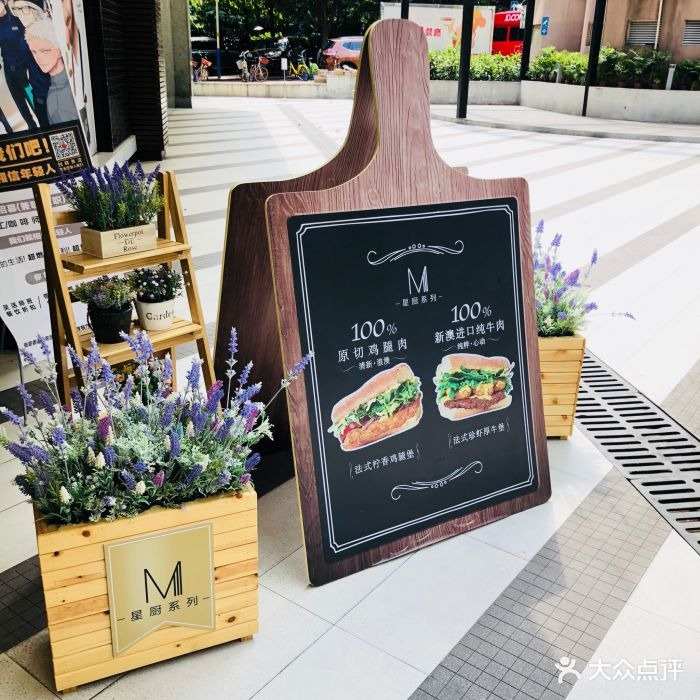

*`08_宜安_ENV_01.jpg`*

> 该店暂未找到公开可下载的：儿童区 实拍。

### 照片来源

- 携程攻略（764 条点评，含 3 张门店照片）：https://you.ctrip.com/food/guangzhou152/5328549-food.html
- Trip.com（门店页与设施信息）：https://tw.trip.com/restaurant/china/guangzhou/detail/mcdonald-s-11478945/
- 大众点评（405 条评论）：https://www.dianping.com/review/237209526

- 本店照片原始出处：大众点评门店相册（用户实拍），经 360 图片搜索索引取得（https://www.dianping.com/guangzhou（原图直链见 photos/_sources.csv））
- 版权说明：图片版权归原作者所有，本档案仅作个人研究与非商业展示
- 明细见 `photos/_sources.csv`

## 网上风评

### 好评

1. 支持自选配料 DIY 汉堡，可以按自己口味搭，这在广州门店里不多见
2. 建设六马路一带外国人聚集，店内客群多元，氛围松弛
3. 就在宜安广场楼下，写字楼办事、逛街都能顺脚进来，近淘金地铁站

### 差评与短板

1. 店不大，周六下午茶时段也会爆满
2. 没有甜品站，买不到甜筒，只能点新地等杯装甜品
3. 入口要下楼梯、不在路边，第一次来不好找

> 口碑内容整合自大众点评、开饭喇、携程 / Trip.com、新浪实测稿等公开页面。点评与开饭喇站点有反爬拦截，相关内容来自搜索引擎摘要，**未经页面原文逐条核对**；差评为归纳转述，非用户原话逐字引用。

## 适合什么场景

写字楼午市 / DIY 汉堡 / 建设六马路一带小坐

## 待核项与数据说明

- 开业时间未查到确切来源，已如实标注「不详」，未做推测。
- 面积未公开，未按照片目测反推。
- 座位数未公开。
- 规模维度为推定值（面积/座位），取候选池同维度中位档，已在此标注。
- 数据采集日期：2026-10-24。榜单与评分每日变动，以上仅为当日快照。

---

*本文件为个人研究用途整理，图片版权归原作者 / 麦当劳中国所有，如有侵权请联系删除。*
