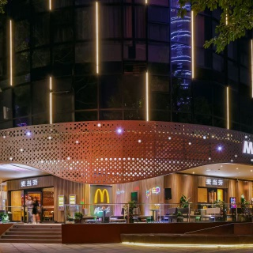
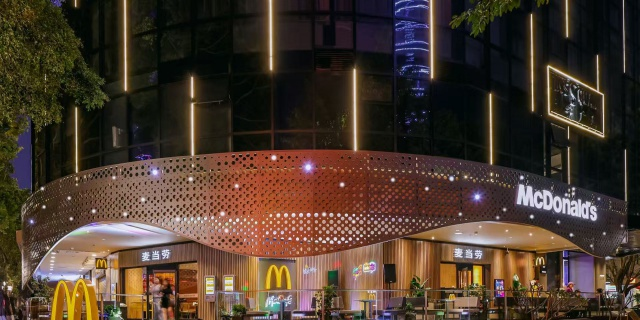
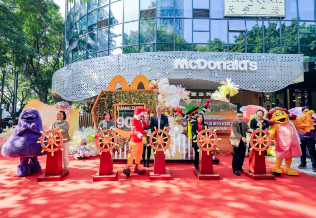
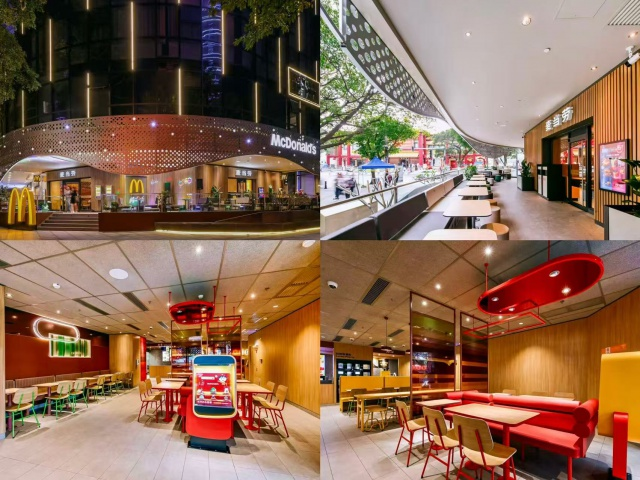

# 麦当劳（天字码头店）

**第 9 名 · 综合指数 48 分 · 入选通道：地标**

越秀区 · 沿江路 / 天字码头 · 珠江边散步歇脚

---

## 基本信息

| 项目 | 内容 |
| --- | --- |
| 门店全称 | 麦当劳（天字码头店） |
| 别名 / 平台写法 | 官方称「沿江中路天字码头餐厅」 |
| 地址 | 越秀区沿江中路 天字码头旁（北京南路路口，珠江夜游天字码头一侧） |
| 地址备注 | 门牌未在公开稿中给出，位置描述以官方新闻稿为准。 |
| 行政区 / 商圈 | 越秀区 / 沿江路 / 天字码头 |
| 高德评分 | 未收录（开业时间短或样本不足） |
| 高德榜单表现 | 未进入所采集的 8 个高德榜单 |
| 开业 / 成立时间 | 2026-01-04 开业，为麦当劳广州市场第 900 家餐厅 |
| 时间来源 | ★ 麦当劳中国官网新闻稿（2026-01-04） |
| 面积 | 未公开 |
| 座位数 | 室内外合计超过 100 座 |
| 店型 / 官方身份 | 全国首家「美味色谱 Classic Spectrum」设计风格餐厅；广州市场第 900 家餐厅 |
| 营业时间 | 未核实（开业不足一年，公开渠道未见稳定营业时间记录） |
| 电话 | 未核实 |
| 交通 | 沿江中路天字码头旁；地铁 6 号线北京路站、2 号线海珠广场站均需步行约 10 分钟 |

## 综合指数（满分 100）

| 维度 | 得分 | 满分 | 说明 |
| --- | --- | --- | --- |
| A 高德榜单表现 | 0 | 40 | 上榜次数 + 最好名次 |
| B 门店规模 | 8 | 20 | 面积 + 座位数 |
| C 商圈能级 | 20 | 20 | 城市级地标 20 / 一级商圈 15 / 区域中心 11 / 成熟社区 7 / 城郊园区 3 |
| D 官方身份 | 20 | 20 | 旗舰、首发、里程碑店型 |
| **合计** | **48** | 100 | 含推定项：面积 |

## 门店与空间

- **面积 / 座位**：未公开；室内外合计超过 100 座
- **店型与身份**：全国首家「美味色谱 Classic Spectrum」设计风格餐厅；广州市场第 900 家餐厅
- **营业时间**：未核实（开业不足一年，公开渠道未见稳定营业时间记录）
- **怎么去**：沿江中路天字码头旁；地铁 6 号线北京路站、2 号线海珠广场站均需步行约 10 分钟

## 实拍

共 4 张，来源：麦当劳中国官网新闻稿（2026-01-04）官方配图（麦当劳中国官网）。图片版权归原作者 / 品牌方所有。

> 核验依据：麦当劳中国官网新闻稿配图（2026-01-04《广州第 900 家餐厅》），画面为本店开业现场。

### 外立面 / 门头（EXT）

*`09_天字码头_EXT_01.jpg`*

*`09_天字码头_EXT_02.jpg`*

*`09_天字码头_EXT_03.jpg`*

### 座位区 / 堂食区（SEAT）

*`09_天字码头_SEAT_01.jpg`*

> 该店暂未找到公开可下载的：点餐前台、儿童区、招牌细节、周边环境 实拍。

### 照片来源

- 麦当劳中国官网新闻稿（本文照片出处）：https://www.mcdonalds.com.cn/news/20260104-900-Restaurants-in-Guangzhou
- 广州日报新花城报道：https://huacheng.gz-cmc.com/pages/2026/01/07/dfe5724778704df383ec231e607221d9.html
- 南方+ 报道：https://www.toutiao.com/w/1853467852371020/

- 本店照片原始出处：麦当劳中国官网新闻稿（2026-01-04）官方配图（https://www.mcdonalds.com.cn/news/20260104-900-Restaurants-in-Guangzhou）
- 版权说明：版权归麦当劳中国所有，本档案仅作个人研究与非商业展示
- 明细见 `photos/_sources.csv`

## 网上风评

### 好评

1. 全国首家「美味色谱」设计门店：外立面做珠江「水波涟漪」造型，夜间灯光沿建筑线条流动，是沿江路新的夜景点位
2. 设室外休闲座区，直接面向珠江边步道开放，可以买完就坐在江边吃
3. 室内外 100+ 座位，配麦咖啡与麦乐送，覆盖早餐通勤到周末休闲

### 差评与短板

1. 开业不足一年，第三方评分样本几乎为零，口碑尚无稳定参考
2. 室外座位完全露天，下雨、暴晒或江风大时基本不可用
3. 作为新晋打卡点，开业期与周末客流集中，排队概率高于普通门店

> 口碑内容整合自大众点评、开饭喇、携程 / Trip.com、新浪实测稿等公开页面。点评与开饭喇站点有反爬拦截，相关内容来自搜索引擎摘要，**未经页面原文逐条核对**；差评为归纳转述，非用户原话逐字引用。

## 适合什么场景

珠江边散步歇脚 / 夜景打卡 / 游客 / 亲子

## 待核项与数据说明

- 高德未收录评分：该店未进入所采集的 8 个高德榜单，评分缺失。
- 面积未公开，未按照片目测反推。
- 规模维度为推定值（面积），取候选池同维度中位档，已在此标注。
- 营业时间 / 电话未核实，开业时间短或公开渠道未披露。
- 数据采集日期：2026-10-24。榜单与评分每日变动，以上仅为当日快照。

---

*本文件为个人研究用途整理，图片版权归原作者 / 麦当劳中国所有，如有侵权请联系删除。*
