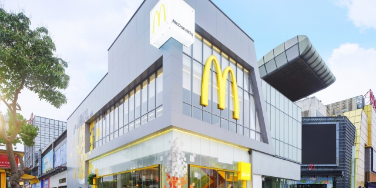
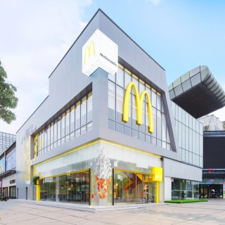
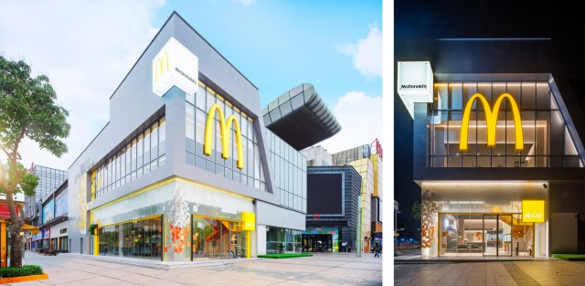
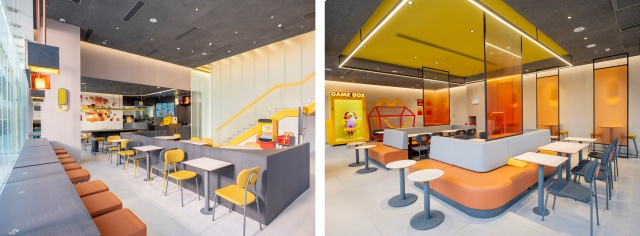
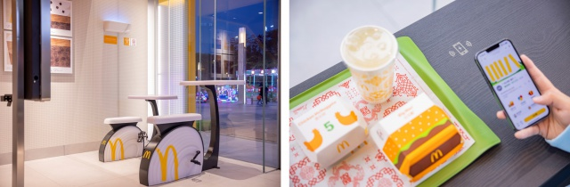
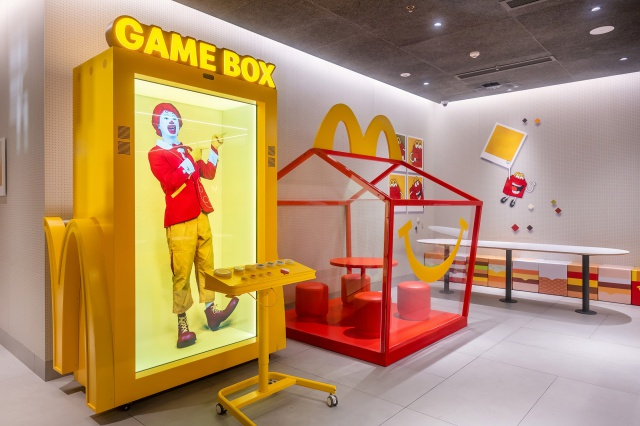
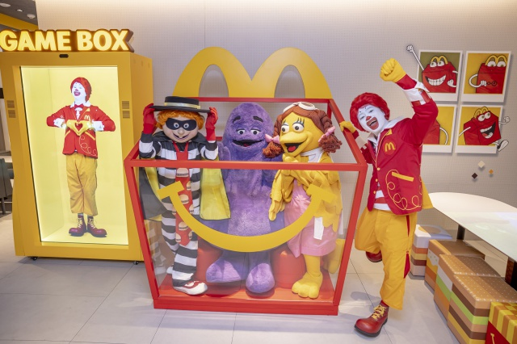

# 麦当劳（白云 CUBE 旗舰店）

**第 10 名 · 综合指数 47 分 · 入选通道：地标**

白云区 · 白云新城 · 亲子一站式遛娃

---

## 基本信息

| 项目 | 内容 |
| --- | --- |
| 门店全称 | 麦当劳（白云 CUBE 旗舰店） |
| 别名 / 平台写法 | 官方称「云城南路餐厅」，位于白云万达广场旁 |
| 地址 | 白云区云城南路 白云万达广场旁（上下两层独栋建筑） |
| 地址备注 | 官方未给门牌号，公开稿均以「白云万达广场旁」「云城南路」定位。 |
| 行政区 / 商圈 | 白云区 / 白云新城 |
| 高德评分 | 未收录（开业时间短或样本不足） |
| 高德榜单表现 | 未进入所采集的 8 个高德榜单 |
| 开业 / 成立时间 | 2023-04-03 开业 |
| 时间来源 | ★ 麦当劳中国官网新闻稿（2023-04-03） |
| 面积 | 超过 430 平方米（上下两层独栋） |
| 座位数 | 135 座 |
| 店型 / 官方身份 | 广州首家、全国第五家 CUBE 风格旗舰餐厅；设计师梁志天主持设计；全国首发「开心魔力盒」；广州首家使用太阳能光伏板辅助照明的门店 |
| 营业时间 | 未核实（公开稿未给营业时间） |
| 电话 | 未核实 |
| 交通 | 白云万达广场旁，白云新城片区；地铁 2 号线飞翔公园站步行约 15 分钟 |

## 综合指数（满分 100）

| 维度 | 得分 | 满分 | 说明 |
| --- | --- | --- | --- |
| A 高德榜单表现 | 0 | 40 | 上榜次数 + 最好名次 |
| B 门店规模 | 14 | 20 | 面积 + 座位数 |
| C 商圈能级 | 15 | 20 | 城市级地标 20 / 一级商圈 15 / 区域中心 11 / 成熟社区 7 / 城郊园区 3 |
| D 官方身份 | 18 | 20 | 旗舰、首发、里程碑店型 |
| **合计** | **47** | 100 | 无推定项 |

## 门店与空间

- **面积 / 座位**：超过 430 平方米（上下两层独栋）；135 座
- **店型与身份**：广州首家、全国第五家 CUBE 风格旗舰餐厅；设计师梁志天主持设计；全国首发「开心魔力盒」；广州首家使用太阳能光伏板辅助照明的门店
- **营业时间**：未核实（公开稿未给营业时间）
- **怎么去**：白云万达广场旁，白云新城片区；地铁 2 号线飞翔公园站步行约 15 分钟

## 实拍

共 7 张，来源：麦当劳中国官网新闻稿（2023-04-03）官方配图（麦当劳中国官网）。图片版权归原作者 / 品牌方所有。

> 核验依据：麦当劳中国官网新闻稿配图（2023-04-03 广州 CUBE 旗舰店开业稿），画面为本店独栋建筑。

### 外立面 / 门头（EXT）

*`10_CUBE_EXT_01.jpg`*

*`10_CUBE_EXT_02.jpg`*

*`10_CUBE_EXT_03.jpg`*

### 座位区 / 堂食区（SEAT）

*`10_CUBE_SEAT_01.jpg`*

*`10_CUBE_SEAT_02.jpg`*

### 儿童区 / 游乐区（KID）

*`10_CUBE_KID_01.jpg`*

*`10_CUBE_KID_02.jpg`*

> 该店暂未找到公开可下载的：点餐前台、招牌细节、周边环境 实拍。

### 照片来源

- 麦当劳中国官网新闻稿（本文照片出处）：https://www.mcdonalds.com.cn/news/20230403-Guangzhou-Cube-Grand-Opening
- FoodTalks 探店稿（另一组实拍）：https://www.foodtalks.cn/news/43247
- 南方+ 报道：https://static.nfnews.com/content/202304/04/c7529761.html

- 本店照片原始出处：麦当劳中国官网新闻稿（2023-04-03）官方配图（https://www.mcdonalds.com.cn/news/20230403-Guangzhou-Cube-Grand-Opening）
- 版权说明：版权归麦当劳中国所有，本档案仅作个人研究与非商业展示
- 明细见 `photos/_sources.csv`

## 网上风评

### 好评

1. 独栋两层 + 全透明落地玻璃，暖色方块堆叠出抽象产品图案，白天通透、夜晚灯光层次最明显
2. 全国首发「开心魔力盒」在二楼：3D 裸眼动画 + 「汉堡挑战赛」互动，旁边还有巨型「开心屋」和产品造型软包凳
3. 一楼子母环保充电单车、可无线充电餐桌、绿色再生塑料餐盘，是广州首批这类配置的门店

### 差评与短板

1. 位于白云新城，离市中心较远，专程过去一趟时间成本高
2. 亲子属性极强，周末儿童区拥挤、噪音大，不适合想安静坐的人
3. 周边商业体分散，除万达外可逛的内容有限

> 口碑内容整合自大众点评、开饭喇、携程 / Trip.com、新浪实测稿等公开页面。点评与开饭喇站点有反爬拦截，相关内容来自搜索引擎摘要，**未经页面原文逐条核对**；差评为归纳转述，非用户原话逐字引用。

## 适合什么场景

亲子一站式遛娃 / 建筑与空间打卡 / 绿色门店体验

## 待核项与数据说明

- 高德未收录评分：该店未进入所采集的 8 个高德榜单，评分缺失。
- 营业时间 / 电话未核实，开业时间短或公开渠道未披露。
- 数据采集日期：2026-10-24。榜单与评分每日变动，以上仅为当日快照。

---

*本文件为个人研究用途整理，图片版权归原作者 / 麦当劳中国所有，如有侵权请联系删除。*
